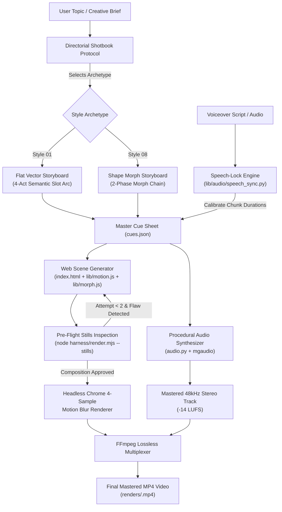

# Autonomous Directing Engine for Canonical Flat Vector & Shape Morph Motion Graphics

* **Author:** Motion Director Architecture Team
* **Status:** Complete Specification (Remediated post-EGM Goldfish Review — Ready for Implementation)
* **Date:** 2026-11-02
* **Reference Benchmark:** [`Vincentwei1021/mg-styles-15`](https://github.com/Vincentwei1021/mg-styles-15) (Upstream Style 03 Flat Vector $\rightarrow$ Local `01-flat-vector`; Upstream Style 06 Shape Morph $\rightarrow$ Local `08-morph`)
* **Predecessor Context:** [`concepts_brief.md`](concepts_brief.md)

---

## Problem Statement

When generating motion graphics from an arbitrary brief, AI agents default to static slide-based layouts rather than continuous kinetic compositions:
1. **The Slide-Deck Fallacy & Isolated Icon Placement:** Instead of cinematic visual storytelling, LLMs generate floating text boxes, explanatory paragraphs, generic cards, and literal isolated icons.
2. **Absence of Kinetic Continuity in Storyboarding:**
   * **In Flat Vector (`01-flat-vector`):** Scenes are partitioned into discrete slides connected by crossfades or static holds, omitting the canonical **one-continuous-shot** paradigm, limb-rigged geometric character animation, and element-driven transitions (shape wipes).
   * **In Shape Morph (`08-morph`):** LLMs attempt direct interpolation between topologically dissimilar shapes without path vertex alignment, resulting in twisted, knotted, and jarring transitions. They omit the foundational requirement: collapsing complex shapes into an intermediate neutral primitive (circle or capsule) over 8 to 12 frames before expanding into the target silhouette.
3. **Audio-Visual Disconnection:** Audio tracks are treated as detached background music rather than a frame-accurate driver. Visual impacts (anticipation, stretch, squash, bounce) do not synchronize with musical onsets or procedural sound hits.
4. **Lack of Pre-Flight Stills Inspection:** Pipelines render full clips without intermediate composition checks, allowing typographic clipping, palette clashes, and static intervals into the final output.

---

## Overview

This architectural design establishes the end-to-end storyboard, directing, and rendering engine for the two primary motion design disciplines within the repository:
* **Style 01 · Flat Vector (`01-flat-vector` / Benchmark 03):** Benchmark Google Material, Buck, and Ordinary Folk. A primary shape moves continuously across a 5–6 tone color field, driving geometric character actions, staggered architectural pop-ups, and element-driven shape wipes.
* **Style 08 · Shape Morph (`08-morph` / Benchmark 06):** Benchmark Apple Keynote and Pentagram identities. A single silhouette transforms into 6 to 8 thematic icons aligned to musical beats, mediated by 240-vertex path resampling, squash/stretch cushions, and Oklab background wipes.

The system enforces a **Storyboard-First Protocol**: before code is generated, the agent constructs a 4-act directorial shotbook with verified geometric metaphors, frame-locked cue sheets (`cues.json`), and pre-flight keyframe stills.

### Taxonomy Mapping Table

| Workspace Slug | Upstream Benchmark ID | Visual Paradigm | Primary Benchmark Reference |
| :--- | :--- | :--- | :--- |
| `01-flat-vector` | Style 03 · Flat Vector | One-Continuous-Shot Explainer | Buck / Ordinary Folk / Popwise |
| `08-morph` | Style 06 · Shape Morph | Metaphoric Morph Chain | Apple Keynote / Morphe |

---

## Goals & Non-Goals

### Goals
* **Goal 1: Directorial Storyboard Grammar for Flat Vector (`01-flat-vector`).**
  Formalize the 4-act narrative pattern: 0.00s to 1.20s Hook (anticipation $\rightarrow$ stretch $\rightarrow$ squash $\rightarrow$ overshoot $\rightarrow$ settle of primary shape), 1.20s to 3.00s World Escalation (staggered geometric emergence), 3.00s to 5.50s Subject Action (limb rig rotations, facial actions), 5.50s to 8.00s Element-Driven Shape Wipe and Choreographed Bursts, 8.00s to 10.00s Brand Lockup with a 1.0s active micro-motion hold.
* **Goal 2: Directorial Storyboard Grammar for Shape Morph (`08-morph`).**
  Formalize the morphological chain: 6 to 8 icon transformation sequence with a mandatory two-phase transition ($A \rightarrow \text{circle/capsule} \rightarrow B$ over 16 to 24 frames), 10% to 15% velocity-aligned squash and stretch, slight axial rotation, and Oklab background color wipes.
* **Goal 3: Deterministic Web Standards Execution Engine.**
  Execute visual choreography via the repository's native stack: HTML5 Canvas / SVG, `lib/motion.js` (closed-form damped springs and `cubic-bezier(0.34, 1.56, 0.64, 1)`), zero-dependency headless Chrome rendering (`harness/render.mjs`), and 4-sample motion blur.
* **Goal 4: Master Frame Sheet & Audio-Visual Clock Arbitration.**
  Lock every visual trigger and transition cut to a single unified frame index (`cues.json`). Reconcile musical beat quantization with continuous voiceover speech onsets using the existing `lib/audio/speech_sync.py` module. Synthesize genre-accurate 48 kHz stereo sound via `mgaudio` and `audio.py`.
* **Goal 5: Bounded Pre-Flight Stills Verification Gate.**
  Render 6 to 10 keyframe stills at critical cue timestamps (`window.renderAt(t)`) via Puppeteer to inspect composition, color balance, negative space, and typographic contrast before rendering the master video, with an iteration ceiling of 2 attempts.

### Non-Goals
* **Non-Goal 1: Multi-Slide Presentation Decks.** Paragraph text, explanatory bullet points, and static card layouts are out of scope.
* **Non-Goal 2: Complex 3D Mesh Deformation.** The engine does not support photorealistic 3D rendering or character mesh skinning; character rigs are limited to planar 2D geometric hierarchies.
* **Non-Goal 3: Disconnected Stock Audio.** The engine does not support generic, unsynchronized audio tracks lacking frame-accurate procedural sound cues.
* **Non-Goal 4: Arbitrary Multi-Ring SVG Boolean Triangulation.** The geometry engine does not attempt general-purpose boolean polygon clipping or complex multi-contour mesh decomposition; compound shapes define explicit secondary hole arrays that scale to zero during intermediate collapse.

---

## Proposed Architecture

### 1. Directorial Shotbook Protocol & Semantic Slot Grammar

The directing engine replaces arbitrary prompt execution with a structured **Shotbook Protocol**. Every generated clip must strictly adhere to one of the two canonical visual structures before any rendering code is written.

#### A. Style 01 · Flat Vector Narrative Arc (10-Second Explainer, 120 BPM, 30 FPS)

The narrative follows an abstract 4-Act Semantic Slot Grammar:

```
[Slot 1: HookSubject] ──► [Slot 2: EnvironmentEscalation] ──► [Slot 3: FocalInteraction] ──► [Slot 4: MetricResolution]
```

* **Act 1: The Kinetic Hook (0.00s to 1.20s / Frames 0–36) — `HookSubject`:**
  - Instantaneous kinetic energy: no static black or blank holds.
  - A single saturated primary primitive enters with downward momentum at frame 0, hits ground impact at frame 15, compresses via velocity-driven squash ($k = -0.22$), rebounds, anticipates backward (10% pullback over 4 frames), and launches vertically at frame 31.
  - The primitive blooms into an expansive focal motif at frame 40, bursting radial accent rays.
* **Act 2: World Escalation & Camera Push (1.20s to 3.00s / Frames 36–90) — `EnvironmentEscalation`:**
  - Center-out staggered emergence of contextual structural elements: $N$ geometric structures emerge with a 3-frame stagger (`stagger(i, 1.46, 3)`), accompanied by secondary atmospheric elements.
  - Camera initiates a continuous spatial push ($z$-axis translation and pan into the focal subject's environment at frame 84).
* **Act 3: Subject Interaction & Shape Wipe (3.00s to 5.50s / Frames 90–165) — `FocalInteraction`:**
  - Spatial transition into the interior scene: flat geometric character or process rig (torso, 2-bone rotating limbs, focal blink at frame 114).
  - Subject action triggers an elastic notification or badge pop-up ($f = 2.6\text{ Hz}, \zeta = 0.38$), followed by anticipatory contraction.
  - **Zero-Cut Transition:** The focal element swells exponentially, driving a full-screen circular shape wipe (`clipShapeWipe`) that clears the interior scene without cuts.
* **Act 4: Rhythmic Choreography & Active Lockup (5.50s to 10.00s / Frames 165–300) — `MetricResolution`:**
  - The hero primitive emerges from the wipe center, hopping across 4 graphic quadrants on the musical downbeats ($t = 6.0\text{ s}, 6.5\text{ s}, 7.0\text{ s}, 7.5\text{ s}$).
  - At $t = 7.5\text{ s}$, the primitive flips edge-on into a 3D-projected metric token, then translates rapidly into the lead bar of an infographic chart.
  - The bar and token morph continuously into the brand wordmark or title.
  - Final 1.5 seconds ($t = 8.5\text{ s}$ to $10.0\text{ s}$): Active hold with micro-oscillations (subtle periodic scale modulation; no static freeze).

*Illustrative Reference Instance:* In `demos/01-flat-vector` (Popwise), `HookSubject` is a coral ball launching into a sun; `EnvironmentEscalation` is a 9-skyscraper skyline and clouds; `FocalInteraction` is an office worker receiving a notification bell; `MetricResolution` is a quadrant hop, gold coin flip, and morph into the "popwise" wordmark.

#### B. Style 08 · Shape Morph Narrative Arc (10-Second Continuous Morph, 150 BPM, 30 FPS)
* **Hero Silhouette Continuity:**
  - A single hero form transforms continuously through 6 to 8 thematic silhouettes (e.g., Drop $\rightarrow$ Coffee Cup $\rightarrow$ Rising Sun $\rightarrow$ Sunset Horizon $\rightarrow$ Sea Gull $\rightarrow$ Supersonic Plane $\rightarrow$ Map Pin $\rightarrow$ Pulsing Heart $\rightarrow$ Brand Wordmark).
* **Two-Phase Intermediate Collapse Requirement:**
  - Direct interpolation between topologically distinct polygons is prohibited to avoid twisted edges.
  - Every transition occurs across 16 to 24 frames ($0.53\text{ s}$ to $0.80\text{ s}$) split into two equal phases:
    1. **Phase 1 (Collapse):** Shape $A$ contracts into a neutral primitive (Circle or Capsule, $22\text{ px} \le r \le 48\text{ px}$) over 8 to 12 frames.
    2. **Phase 2 (Bloom):** The neutral primitive blooms into Shape $B$ over the remaining 8 to 12 frames.
* **Squash, Stretch & Axial Rotation:**
  - At the midpoint of the morph, the silhouette experiences 10% to 15% velocity-directed elongation ($\text{scale}_x, \text{scale}_y$) and an axial tilt of $6^{\circ}$ to $14^{\circ}$.
* **Oklab Background Field Wipes:**
  - Background color shifts are triggered on morph impact frames, blending in the perceptual Oklab color space to eliminate desaturation or muddy brown midpoints.

---

### 2. Kinematic State Machine & Geometry Engines

The visual engine is composed of two mathematical modules:
```
lib/
├── motion.js     # Existing: Damped springs, cubic-bezier curves, velocity squash/stretch, shape wipes
└── morph.js      # New: 240-vertex path sampling, polygon alignment, Oklab color mixing
```

#### A. Spring Kinematics & Bezier Easing (`lib/motion.js` — Existing Module)
The repository's foundational module `lib/motion.js` exposes:
* **Damped Harmonic Oscillator (`spring`):**
  $$x(t) = 1 - e^{-\zeta \omega t} \left( \cos(\omega_d t) + \frac{\zeta \omega}{\omega_d} \sin(\omega_d t) \right)$$
  where $\omega = 2\pi f$ and $\omega_d = \omega \sqrt{\max(0.0001, 1 - \zeta^2)}$.
* **Spring Pop with Velocity Squash (`pop`):**
  Evaluates `spring(tt, f, z)` and couples the derivative `springV` to squash factor $k$. When $t > t_{\text{pin}}$, scale is pinned to exactly 1.0 and squash to 0.0 to eliminate sub-pixel shimmering.
* **Velocity Squash & Stretch (`applySquashStretch`):**
  Scales the parallel motion axis by $(1 + v \cdot k)$ and compresses the perpendicular axis by $1 / \sqrt{1 + v \cdot k}$ to guarantee strict conservation of 2D visual area.
* **Overshoot Curve (`overshootEase`):**
  The engine evaluates the overshoot curve using a 10-iteration Newton-Raphson numerical inversion of `cubic-bezier(0.34, 1.56, 0.64, 1)`.
* **Anticipation (`anticipation`):** Pulls back by $4\%$ to $10\%$ over 3 to 4 frames prior to launch.
* **Element-Driven Shape Wipe (`clipShapeWipe`):** Clips canvas context to an expanding circular mask.

#### B. 240-Vertex Morphing & Alignment Engine (`lib/morph.js` — Modular Extraction)
* **Single-Contour Contract & Compound Shape Policy:**
  `resamplePoly` operates strictly on closed single-contour polygons ($N = 240$). For multi-contour shapes (e.g. cup handle, letter counters), shapes define explicit secondary hole polygon arrays ($N_H = 72$). During Phase 1 (Collapse), holes scale to radius zero at their centroid, ensuring that the intermediate neutral shape is always a simple 1-manifold polygon.
* **Perimeter Resampling (`resamplePoly(P, 240)`):**
  An arbitrary SVG path silhouette is sampled into $N = 240$ equidistant vertices along its perimeter:
  $$\text{length}(P) = \sum_{i=1}^M \| p_i - p_{i-1} \|$$
* **Winding Order Normalization (`orient(P)`):**
  Computes signed area via the Shoelace formula:
  $$\text{area}(P) = \frac{1}{2} \sum_{i=0}^{N-1} (x_i y_{i+1} - x_{i+1} y_i)$$
  If $\text{area}(P) < 0$, the vertex array is reversed to guarantee clockwise orientation prior to alignment.
* **Centroid Normalization & Minimum-Distance Alignment (`bestShift(A, B)`):**
  Translates both polygons to $(0,0)$ using `centroid(P)`. Evaluates the optimal circular shift index $s^* \in [0, N-1]$ that minimizes Euclidean point drift:
  $$s^* = \operatorname*{arg\,min}_{s} \sum_{i=0}^{N-1} \| A_i - B_{(i+s) \pmod N} \|^2$$
  Eliminates path knots, self-intersections, and rotational phase discontinuities.
* **Canonical Neutral Primitives (`circ`, `capsule`):**
  - `circ(cx, cy, r, n = 240)`: Evaluates $x_i = cx + r\cos(2\pi i / n)$, $y_i = cy + r\sin(2\pi i / n)$.
  - `capsule(cx, cy, w, h, r, n = 240)`: Total width $w$, height $h$, cap radius $r = \min(w, h)/2$. For $w \ge h$, linear length $L = w - 2r$, perimeter $P = 2L + 2\pi r$. Samples $s_i = P \cdot i / n$ piecewise across the two linear segments and two semicircular caps.
* **Perceptually Uniform Color Mixing (`mixC(c1, c2, t)`):**
  Transforms sRGB hexadecimal colors into linear Oklab color space ($L, a, b$), executes linear interpolation, and converts back to sRGB:
  $$\text{Oklab}(t) = (1 - t) \cdot \text{Oklab}(c_1) + t \cdot \text{Oklab}(c_2)$$

---

### 3. Master Frame Sheet (`cues.json`) & Audio-Visual Coupling

All visual animations and audio events synchronize to frame indices defined in a single contract file: `cues.json`.

#### A. Schema Definition (`cues.json`)
```json
{
  "style": "01-flat-vector",
  "fps": 30,
  "bpm": 120,
  "duration": 10.0,
  "beat_interval": 0.5,
  "build": 4.0,
  "drop": 6.0,
  "outro": 8.0,
  "stills": [0.50, 1.35, 3.80, 5.00, 6.50, 9.20],
  "frames": {
    "impact1": 15,
    "anticipation": 27,
    "launch": 31,
    "sunLand": 40,
    "bldStart": 44,
    "bldStagger": 3,
    "cameraPush": 90,
    "charArrive": 112,
    "notificationPop": 120,
    "shapeWipe": 150,
    "burst1": 180,
    "burst2": 195,
    "burst3": 210,
    "burst4": 225,
    "coinFlip": 233,
    "logoSettle": 240
  }
}
```

#### B. Visual Renderer Coupling
The web component calculates relative time offsets directly from `cues.frames`:
$$t_{\text{rel}} = t - \frac{\text{frames}[\text{key}]}{\text{fps}}$$

#### C. Audio-Visual Clock Arbitration Hierarchy
To prevent synchronization drift between rigid musical tempos and spoken voiceover, the system enforces an explicit two-mode clock arbitration hierarchy using the existing `lib/audio/speech_sync.py` module:
* **Mode A: Music-Driven Rhythmic Reel (Default):**
  - Visual cues lock strictly to the musical grid (120 BPM for Flat Vector, 150 BPM for Shape Morph).
  - If voiceover narration is present, `speech_sync.py` uses `snap_to_grid(t)` to pad or time-scale spoken audio chunks so that speech pauses align with musical downbeats.
* **Mode B: Voiceover-First Explainer Film:**
  - Voiceover audio dictates the overarching pace. `speech_sync.py` executes upstream, detecting syllabic pauses and generating `cues.json` with dynamic shot durations snapped to musical bar divisions.
  - Procedural music (`mgaudio`) shifts from rigid percussion to harmonic pad/ambient stems that adapt to the calculated shot boundaries.

---

### 4. Pre-Flight Stills Verification Pipeline

To prevent unnecessary video rendering and detect layout, contrast, and typography defects before encoding, the harness provides a stills generator:
```bash
node harness/render.mjs demos/01-flat-vector --stills
```

#### A. Stills Cue Resolution Chain
When `--stills` is invoked, `harness/render.mjs` resolves sample timestamps $T_{\text{stills}}$ via a deterministic fallback chain:
1. Explicit CLI arguments: e.g. `--stills 0.5,2.0,4.25`.
2. Dedicated cue array: `cues.stills` if present in `cues.json`.
3. Inflection frame mapping: if `cues.frames` is present, maps keyframe names (`['impact1', 'push', 'wipe', 'burst1', 'logoSettle']`) to seconds via $t = \text{frame} / \text{fps}$.
4. Land object mapping: if `cues.land` is present (Style 08), takes the first 6 timestamp values.
5. Standard fallback array: $T_{\text{stills}} = [0.50, 1.35, 3.80, 5.00, 6.50, 9.20]$.

#### B. In-Browser Rec. 709 Luminance Verification
To verify that frames are not blank without requiring native Node.js image decoding dependencies (`sharp`, `pngjs`), Puppeteer executes a canvas evaluation prior to saving the screenshot:
```javascript
const luma = await page.evaluate(() => {
  const c = document.querySelector('canvas') || document.querySelector('svg');
  // Sample pixels on a 64x36 thumbnail canvas
  const thumb = document.createElement('canvas');
  thumb.width = 64; thumb.height = 36;
  const tctx = thumb.getContext('2d');
  tctx.drawImage(c, 0, 0, 64, 36);
  const data = tctx.getImageData(0, 0, 64, 36).data;
  let sum = 0;
  for (let i = 0; i < data.length; i += 4) {
    sum += 0.2126 * data[i] + 0.7152 * data[i + 1] + 0.0722 * data[i + 2];
  }
  return sum / (64 * 36 * 255);
});
```

#### C. Manifest Output Schema (`out/stills/manifest.json`)
```json
{
  "demo": "01-flat-vector",
  "generatedAt": "2026-11-02T09:45:00.000Z",
  "stills": [
    {
      "index": 0,
      "filename": "t00.50.png",
      "timestamp": 0.50,
      "meanLuminance": 0.312,
      "isNonBlank": true
    }
  ]
}
```

---

### 5. Procedural 48kHz Stereo Audio Engine (`mgaudio` DSP)

The project includes an in-tree Python audio synthesis engine (`lib/audio/` and `audio.py`) that generates 48 kHz stereo stems:
* **Drum Synthesis:** Mathematical synthesis of 808/909 kicks, snares, rimshots, and hi-hats.
* **Synthesizer Engine:** Additive and subtractive wavetable chords with low-pass cutoff sweeps (`moog_filter`) locked to `cues.build` and `cues.drop`.
* **Procedural SFX:**
  - `pop`: Fast exponential sine chirp ($800\text{ Hz} \rightarrow 200\text{ Hz}$ over $45\text{ ms}$).
  - `whoosh`: Bandpass-filtered white noise sweep timed with shape wipes.
  - `impact`: Damped sub-bass impulse ($60\text{ Hz}$ decaying over $350\text{ ms}$).
* **Mastering Compliance:**
  Automated loudness mastering to EBU R128 standard (-14 LUFS integrated, -1 dBFS true peak).

---

### 6. Architectural Data Flow



---

## Alternatives Considered

### Alternative 1: Remotion / React Three Fiber Stack (`@remotion/core`)
* **Description:** Authoring motion graphics as React components using Remotion's runtime (`useCurrentFrame`, `spring`, `interpolate`) and CLI bundler.
* **Why it was rejected:**
  1. *Aesthetic Bias toward "Slide Decks":* LLMs generating Remotion code default to standard UI layouts (floating cards, CSS flexboxes, and text-bullet cards), producing static slide-deck compositions.
  2. *Rendering Overhead & Bundling Latency:* Remotion requires Webpack/Vite bundling and heavy React reconciliation passes on every frame. A 10-second 1080p clip takes 45 to 90 seconds to render in Remotion, whereas the repository's native Headless Chrome harness renders 300 frames in 30 to 50 seconds with 4-sample motion blur.
  3. *Lack of Built-in Geometric Kinematics:* Remotion lacks native 240-vertex polygon resampling, path alignment algorithms (`bestShift`), and Oklab color mixing, requiring additional third-party dependencies that complicate headless execution.
* **Viability Conditions:** Viable if converted into a public SaaS editor where users interactively edit React components in a browser UI.

---

### Alternative 2: Generative Video Diffusion Models (Runway Gen-3 / Sora / HunyuanVideo)
* **Description:** Synthesizing motion design clips directly via cloud text-to-video or image-to-video generative AI diffusion models.
* **Why it was rejected:**
  1. *Frame-Accurate Synchronization Failure:* Generative diffusion models operate probabilistically. They cannot guarantee that a character blinks at frame 114 or that a shape wipe strikes at frame 150.
  2. *Topological Drift & Artifacts:* Vector motion design requires exact geometric continuity. Diffusion models exhibit topological distortion, edge jitter, limb artifacts, and blurred typography.
  3. *Cost & Quota Friction:* Cloud video APIs cost \$0.20 to \$0.50 per generation, take minutes to process, and impose rate limits. The local canvas engine runs deterministically, offline, with zero API cost.
* **Viability Conditions:** Viable for auxiliary atmospheric background plates pre-rendered and composited behind vector geometry.

---

### Alternative 3: Declarative Lottie / Bodymovin JSON Synthesis
* **Description:** Generating Adobe After Effects-compatible Lottie JSON files and rendering them using `lottie-web`.
* **Why it was rejected:**
  1. *Opaque AST Architecture:* Generating raw Lottie JSON from an LLM requires synthesizing thousands of lines of deeply nested bezier control points, leading to frequent syntax corruption and crashes that are difficult to trace.
  2. *Dynamic Physics Limitations:* Simulating closed-form damped harmonic springs, velocity-directed squash/stretch, and dynamic collision responses inside Lottie JSON requires precomputing and baking dense per-frame animation paths.
  3. *Lack of Native Procedural Audio:* Lottie files have no awareness of audio waveforms or frame-level DSP synthesis.
* **Viability Conditions:** Viable if distribution strictly demanded compact vector runtime animations for embedded native mobile applications.

---

### Alternative 4: Open-Source Vector Morphing Libraries (Flubber.js / GSAP MorphSVG)
* **Description:** Integrating external vector morphing libraries (Flubber.js or GSAP MorphSVG) to handle polygon interpolation.
* **Why it was rejected:**
  1. *Dependency Footprint & Offline Headless Invariant:* Flubber.js requires npm package bundling or CDN resolution, violating the repository's invariant of zero-dependency, self-contained HTML demo files playable offline directly in any browser.
  2. *Commercial Licensing & Closed Ecosystem:* GSAP MorphSVG is a closed-source, commercially licensed plugin unsuitable for open-source agent tooling.
  3. *Omission of Two-Phase Directorial Convention:* Flubber.js performs direct shape-to-shape morphing via triangulation. While mathematically robust for arbitrary multi-ring SVGs, direct morphing produces unnatural twisting when transforming vastly different brand silhouettes (e.g. cup to plane). The canonical Apple Keynote aesthetic strictly mandates collapsing to an intermediate neutral circle or capsule ($A \rightarrow \text{circle} \rightarrow B$), which makes custom 240-vertex resampling simpler, cleaner, and visually superior.
* **Viability Conditions:** Viable if the engine were expanded to morph complex typographic letterforms with dozens of interior holes without passing through a neutral primitive.

---

## Risks, Boundaries & Mitigations

| Risk | Impact | Probability | Mitigation Strategy |
| :--- | :--- | :---: | :--- |
| **SVG DOM Requirement in Pure Node.js** | `sampleD` relies on SVG DOM methods (`getTotalLength`, `getPointAtLength`) which do not exist in Node.js. | Low | Explicitly scope `sampleD` as requiring a DOM context (Browser or Puppeteer via hidden `<svg>` element). In pure Node.js environments, throw an informative error. Numerical unit tests for `resamplePoly`, `bestShift`, and `mixC` operate on coordinate arrays without DOM dependencies. |
| **Oklab Gamut Clipping on Saturated Primaries** | Blending highly saturated primary colors may produce out-of-gamut sRGB values (`> 1` or `< 0`). | Low | `fromOklab` explicitly clamps sRGB channels using `clamp(toSrgb(clamp(c))) * 255` before hex encoding. |
| **Puppeteer Font Loading Race Condition** | Capturing stills before custom web fonts (`Fredoka`, `Outfit Morph`) are active results in layout shifts. | Medium | Harness explicitly evaluates `await document.fonts.ready` inside Puppeteer before invoking `window.renderAt(t)`. All custom fonts are stored locally in `demos/<slug>/assets/fonts/` with `@font-face` declarations. |
| **Unbounded Pre-Flight Inspection Loop** | Scene generator repeatedly fails composition checks, consuming excessive compute/tokens. | Medium | Cap inspection iterations at `MAX_INSPECTION_ATTEMPTS = 2`. If flaws persist, emit diagnostic `manifest.json` and fail closed. |
| **Regression Risk on Existing Demos** | Extracting `lib/morph.js` might regress existing standalone demo files. | Low | `lib/morph.js` introduces clean additive exports without mutating existing demo files in `demos/01-flat-vector` and `demos/08-morph`. |

---

## Detailed Implementation Plan

The implementation plan organizes tasks into five sequential phases ordered by dependency. Each phase specifies target files, interfaces, dependencies, and risk mitigations.

```
Phase 1: Directorial Protocol & Knowledge Base (Guides & Prompts)
   │
   ▼
Phase 2: Core Geometric & Morphing Library (lib/morph.js)
   │
   ▼
Phase 3: Harness Stills Generator (--stills in harness/render.mjs)
   │
   ▼
Phase 4: Directorial Rubric Calibration (resources/rubrics/motion-director-rubric.md)
   │
   ▼
Phase 5: Automated Verification & Unit Tests (tests/test_directing_engines.mjs)
```

---

### Phase 1: Directorial Protocol & Knowledge Base

#### 1.1 Create Directorial Guide: Flat Vector
* **Path:** `.agents/skills/cinematic-motion-director/references/directorial_flat_vector_guide.md`
* **Action:** Create
* **Dependencies:** None
* **Details:**
  - Defines the 4-act semantic slot storyboard structure:
    1. Act 1: Kinetic Hook (0.00s to 1.20s): `HookSubject` (falling hero primitive, anticipation pullback, ground squash/stretch, vertical launch into radial burst).
    2. Act 2: World Escalation (1.20s to 3.00s): `EnvironmentEscalation` (center-out staggered emergence of contextual structures, spatial camera push).
    3. Act 3: Subject Action & Shape Wipe (3.00s to 5.50s): `FocalInteraction` (flat geometric character/diagram rig with 2-segment rotating limbs, eye blink at frame 114, elastic notification pop-up, exponential circular shape wipe `clipShapeWipe`).
    4. Act 4: Quadrant Choreography & Active Hold (5.50s to 10.00s): `MetricResolution` (4-quadrant musical beat hops, coin flip, bar-to-stem morph, 1.0s active hold with periodic micro-oscillation).
  - Palettes: 5–6 pure tones (Ultramarine `#2B2BFF`, Coral `#FF5A4E`, Sunflower `#FFC62B`, Mint `#2EE6A8`, Cream `#FFF6E9`, Ink `#151433`).
  - Prohibited elements: Text bullets, multi-slide cuts, and detached floating cards.

#### 1.2 Create Directorial Guide: Shape Morph
* **Path:** `.agents/skills/cinematic-motion-director/references/directorial_shape_morph_guide.md`
* **Action:** Create
* **Dependencies:** None
* **Details:**
  - Defines the Metaphoric Morph Chain:
    - 6 to 8 icon progression sequence mapped to rhythmic musical beats (BPM 150).
    - **Two-Phase Intermediate Collapse Requirement:** Every morph from complex silhouette $A$ to silhouette $B$ must collapse into a neutral circle or capsule ($22\text{ px} \le r \le 48\text{ px}$) over 8 to 12 frames before expanding into target $B$. Direct polygon morphing without intermediate collapse fails validation.
    - Velocity-directed squash and stretch (10% to 15%) during intermediate transit.
    - Perceptual background field wipes using Oklab space blending (`mixC`).

#### 1.3 Update Main Skill Specification
* **Path:**
  1. `.agents/skills/cinematic-motion-director/SKILL.md`
  2. `C:\Users\Hill\.gemini\config\plugins\motion-director\skills\cinematic-motion-director\SKILL.md`
* **Action:** Modify
* **Dependencies:** Steps 1.1, 1.2
* **Details:**
  - Mandate referencing `directorial_flat_vector_guide.md` when Style 01 (`01-flat-vector`) is selected and `directorial_shape_morph_guide.md` when Style 08 (`08-morph`) is selected.
  - Enforce Creative Gate 1 Shotbook schema validation before code generation.

---

### Phase 2: Core Geometric & Morphing Library (`lib/morph.js`)

#### 2.1 Implement Geometry Module (`lib/morph.js`)
* **Path:** `lib/morph.js`
* **Action:** Create
* **Dependencies:** None (zero-dependency ES module with Node & Browser dual export)
* **API Signatures & Algorithmic Contracts:**

```javascript
/**
 * Samples an SVG path definition string into N 2D coordinate vertices.
 * Requires a DOM environment (Browser or Puppeteer page with SVG DOM).
 * @param {string} d - SVG path data string
 * @param {number} [n=240] - Number of sample points
 * @param {boolean} [closed=true] - Whether the path is closed
 * @returns {Array<[number, number]>}
 */
export function sampleD(d, n = 240, closed = true);

/**
 * Resamples an arbitrary closed polygon into exactly N equidistant perimeter points.
 * @param {Array<[number, number]>} P - Input vertex array (length >= 3)
 * @param {number} [n=240] - Desired vertex count
 * @returns {Array<[number, number]>}
 */
export function resamplePoly(P, n = 240);

/**
 * Calculates the signed area of a 2D polygon using the Shoelace formula.
 * @param {Array<[number, number]>} P
 * @returns {number} Signed area (positive = counter-clockwise, negative = clockwise)
 */
export function area(P);

/**
 * Enforces uniform clockwise winding order on a 2D polygon.
 * @param {Array<[number, number]>} P
 * @returns {Array<[number, number]>} Clockwise-oriented polygon
 */
export function orient(P);

/**
 * Computes the arithmetic centroid of a 2D polygon.
 * @param {Array<[number, number]>} P
 * @returns {[number, number]} [centerX, centerY]
 */
export function centroid(P);

/**
 * Finds the circular shift index that minimizes sum of squared Euclidean distances between polygons A and B.
 * Translates both polygons to (0,0) before evaluation.
 * @param {Array<[number, number]>} A
 * @param {Array<[number, number]>} B
 * @returns {number} Optimal circular shift index
 */
export function bestShift(A, B);

/**
 * Shifts polygon B to align with polygon A, eliminating path twisting.
 * @param {Array<[number, number]>} A
 * @param {Array<[number, number]>} B
 * @returns {Array<[number, number]>} Aligned polygon B
 */
export function alignTo(A, B);

/**
 * Linearly interpolates corresponding vertices between two resampled polygons.
 * @param {Array<[number, number]>} A
 * @param {Array<[number, number]>} B
 * @param {number} t - Interpolation parameter [0, 1]
 * @returns {Array<[number, number]>}
 */
export function lerpP(A, B, t);

/**
 * Generates an N-vertex circle polygon.
 * @param {number} cx - Center X coordinate
 * @param {number} cy - Center Y coordinate
 * @param {number} r - Radius
 * @param {number} [n=240] - Vertex count
 * @returns {Array<[number, number]>}
 */
export function circ(cx, cy, r, n = 240);

/**
 * Generates an N-vertex rounded capsule polygon.
 * @param {number} cx - Center X coordinate
 * @param {number} cy - Center Y coordinate
 * @param {number} w - Total bounding box width
 * @param {number} h - Total bounding box height
 * @param {number} [r] - Cap radius (defaults to min(w, h) / 2)
 * @param {number} [n=240] - Vertex count
 * @returns {Array<[number, number]>}
 */
export function capsule(cx, cy, w, h, r, n = 240);

/**
 * Converts a hexadecimal color string to Oklab coordinates [L, a, b].
 * @param {string} hex - Hexadecimal color code (#RRGGBB)
 * @returns {[number, number, number]}
 */
export function oklab(hex);

/**
 * Converts Oklab coordinates [L, a, b] to a hexadecimal color string.
 * Clamps out-of-gamut sRGB values.
 * @param {[number, number, number]} lab
 * @returns {string} Hexadecimal color code
 */
export function fromOklab([L, a, b]);

/**
 * Linearly blends two hex colors in Oklab perceptual color space.
 * @param {string} hex1 - Initial hex color
 * @param {string} hex2 - Target hex color
 * @param {number} t - Interpolation factor [0, 1]
 * @returns {string} Interpolated hex color
 */
export function mixC(hex1, hex2, t);

// Namespace Dual-Export
export const Morph = {
  sampleD, resamplePoly, area, orient, centroid,
  bestShift, alignTo, lerpP, circ, capsule,
  oklab, fromOklab, mixC
};
if (typeof window !== 'undefined') window.Morph = Morph;
```

---

### Phase 3: Harness Pre-Flight Stills Inspection

#### 3.1 Extend Headless Chrome Harness (`harness/render.mjs`)
* **Path:** `harness/render.mjs`
* **Action:** Modify
* **Dependencies:** None
* **Details:**
  - Parse CLI argument `--stills`:
    - If `typeof args.stills === 'string'`, split explicit comma-separated timestamps.
    - If `args.stills === true`, resolve sample timestamps via deterministic fallback: `cues.stills` $\rightarrow$ `cues.frames` $\rightarrow$ `cues.land` $\rightarrow$ standard fallback array $[0.50, 1.35, 3.80, 5.00, 6.50, 9.20]$.
  - Evaluate `window.renderAt(t)` directly in Puppeteer at each sample timestamp rather than sequentially rendering all 300 frames.
  - Calculate in-browser Rec. 709 mean luminance ($Y = 0.2126R + 0.7152G + 0.0722B$) via `page.evaluate()` on a downscaled thumbnail canvas.
  - Save uncompressed PNG captures into `<demo_dir>/out/stills/tXX.XX.png`.
  - Write metadata summary to `<demo_dir>/out/stills/manifest.json`.

---

### Phase 4: Directorial Rubric Calibration

#### 4.1 Update Motion Director Rubric (`resources/rubrics/motion-director-rubric.md`)
* **Path:** `resources/rubrics/motion-director-rubric.md`
* **Action:** Modify
* **Dependencies:** Phase 1
* **Details:**
  - Under Dimension 3 (`motion_craft`):
    - Add rule: For Style 08 (`08-morph`), every morph between complex silhouettes must collapse into an intermediate neutral circle or capsule over 8 to 12 frames. Direct shape-to-shape morphing without intermediate collapse triggers defect `DIRECT_SHAPE_MORPH_DEFECT`.
    - Add rule: For Style 01 (`01-flat-vector`), transitions must be element-driven (shape wipes or continuous camera push). Static cuts or crossfades to blank screens trigger defect `DISCONNECTED_SLIDE_DEFECT`.
    - Add rule: Anticipation (4% to 10% pullback) must precede explosive launches. Velocity-driven squash/stretch must conserve 2D visual area.
  - Under Dimension 6 (`sound_sync`):
    - Verify that visual cue hits match `cues.json` timestamps within $\pm 1$ frame.
  - Under Section 2 (Fatal Defect Flags):
    - Formally register `DIRECT_SHAPE_MORPH_DEFECT` and `DISCONNECTED_SLIDE_DEFECT`.

---

### Phase 5: Automated Verification & Unit Tests

#### 5.1 Implement Kinematics & Geometry Test Suite
* **Path:** `tests/test_directing_engines.mjs`
* **Action:** Create
* **Dependencies:** Phase 2, Phase 3
* **Concrete Numeric Assertions:**
  - **Test 1 (`resamplePoly`):** Input square $P = [[0,0], [100,0], [100,100], [0,100]]$. Assert output length is exactly 240. Assert all adjacent perimeter point distances $d_i$ satisfy $|d_i - 400/240| < 10^{-3}$.
  - **Test 2 (`bestShift` & `orient`):** Let $A$ be a 240-vertex circle, and $B$ be $A$ circularly shifted by 60 indices. Assert `bestShift(A, B) === 180` or `bestShift(B, A) === 60`. Let $C$ be $A$ in reverse order; assert `orient(C)` restores clockwise orientation identical to $A$.
  - **Test 3 (`mixC` Oklab Chroma):** Input Pure Red `#FF0000` and Pure Cyan `#00FFFF`. Evaluate midpoint $M = \text{mixC}('\text{#FF0000}', '\text{#00FFFF}', 0.5)$. Convert $M$ to Oklab and assert chroma $\sqrt{a^2 + b^2} > 0.04$ (verifying that no desaturation dip to gray `#808080` occurs).
  - **Test 4 (`capsule` Geometry):** Generate $K = \text{capsule}(0, 0, 200, 100, 50, 240)$. Assert length is 240, bounding width is $200 \pm 10^{-3}$, bounding height is $100 \pm 10^{-3}$, and centroid is $(0, 0) \pm 10^{-3}$.
  - **Test 5 (`pop` Pinning):** Invoke `pop(1.0, 0.0, 2.4, 0.42, 0.12, 0.9)`. Assert return value is strictly `[1, 0]`.
  - **Test 6 (`harness --stills`):** Execute `node harness/render.mjs demos/01-flat-vector --stills`. Assert `manifest.json` exists, contains $\ge 6$ entries, each PNG file exists, file size $> 1024$ bytes, and all `isNonBlank === true`.

#### 5.2 Integrate with Workspace Integrity Suite
* **Path:** `tests/test_engine_integrity.ts`
* **Action:** Modify
* **Details:**
  - Add assertion checking the existence of `lib/morph.js` and verifying that `MorphCraft` / `Morph` exports all 12 canonical functions.
  - Verify that `resources/rubrics/motion-director-rubric.md` contains the new Fatal Defect flags.

---

### Rollback Strategy & Defensive Guards

1. **Rollback Procedures:**
   - All Phase 3 modifications to `harness/render.mjs` are isolated behind the `--stills` CLI flag branch. The default full-render pipeline (`--mb 4`) remains untouched. If a regression occurs, execute `git checkout HEAD -- harness/render.mjs`.
2. **Defensive Guards in `lib/morph.js`:**
   - `resamplePoly`: Throw `TypeError('resamplePoly requires at least 3 vertices')` if $P.length < 3$.
   - `mixC`: Validate 6-character hex format `/^#[0-9A-Fa-f]{6}$/`; fallback gracefully to `hex1` on parse failure.
   - `sampleD`: Check `typeof document !== 'undefined'`; throw `Error('sampleD requires a DOM environment')` if invoked in pure Node.js.
