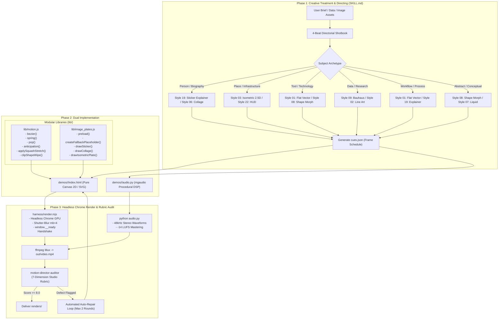

# Design Document: Motion Director Dynamic Directing & Asset Integration Engine

* **Feature Name:** Motion Director Dynamic Directing & Asset Integration Engine
* **Author:** Motion Director Architecture Team
* **Status:** Approved (Post-EGM Swarm Revision)
* **Date:** 2026-11-01
* **Research Reference:** [RESEARCH_CANONICAL_MOTION_DIRECTING_AND_STORYBOARDING.md](../RESEARCH_CANONICAL_MOTION_DIRECTING_AND_STORYBOARDING.md)
* **Review Audit Report:** [consolidated_review_report.md](consolidated_review_report.md)

--------------------------------------------------------------------------------

## 1. Overview

Based on deep technical research into the benchmark 15 canonical motion styles (`mg-styles-15`), this document establishes the architecture to eliminate the three systemic failure modes observed when the Motion Director agent directs films from arbitrary user data:
1. **Directorial Inertia & Slide-Deck Regression:** The agent summarizing text into descriptive paragraphs or bullet cards rather than translating the subject into a 4-beat kinetic visual metaphor with 1–3 monumental words.
2. **Kinetic Stiffness:** Lapsing into linear interpolations or default CSS transitions rather than enforcing closed-form physical dynamics (`anticipation`, velocity-driven `squash & stretch`, and canonical `overshoot` springs).
3. **Naked Rectangle Image Integration:** Pasting raw, unstyled image rectangles into scenes like a PowerPoint presentation, rather than employing studio-grade photographic treatments (Stickerization, Paper Collage, or Isometric 2.5D Plates).

---

## 2. Problem Statement & Root Cause Analysis

### 1. Directorial & Narrative Inertia (The Slide-Deck Trap)
* **Root Cause:** When an LLM receives an open brief (e.g. introducing a scientist, an institution, or an algorithm), it reflexively acts as a text summarizer, creating floating text boxes, subtitle bars, or static multi-line cards.
* **Benchmark Standard (`rubric.md` & `template.md`):** World-class motion design strictly caps total on-screen text to **1 to 3 monumental words per act** (e.g. "ONE DOT", "70+ ELEMENTS", "ISOPOLIS"). The entire narrative weight is carried by an evolving geometric metaphor over a rigid 4-beat temporal architecture:
  - `Act 1: Hook (0.0–0.5s / f0–f15)`: Instant kinetic entry; zero void or static span.
  - `Act 2: Progression (0.5–6.0s / f15–f180)`: One hero moves at a time with 2–4 frame stagger; continuous kinetic evolution.
  - `Act 3: Climax (6.0–7.5s / f180–f225)`: Major transformation (screen-filling shape wipe, multi-element burst, or topological morph).
  - `Act 4: Living Hold (7.5–10.0s / f225–f300)`: Composed end lockup held for 0.8–1.2s with organic breathing micro-motion ($\pm 1\%$ scale / subtle luminance pulse).

### 2. Physical Craft Under-Utilization (The Stiff Motion Defect)
* **Root Cause:** Without shared mathematical primitives, the agent writes raw linear formulas ($x = t \cdot 100$) or generic polynomial approximations that possess non-zero initial jerk, omitting:
  - **Anticipation:** A -4% to -10% pre-launch pullback in the opposite direction for 3–6 frames.
  - **Velocity-Driven Squash & Stretch:** Deformation aligned with the instantaneous motion vector ($\Delta \text{scale}_\parallel = 1 + k \cdot |v|, \Delta \text{scale}_\perp = 1 / \sqrt{\Delta \text{scale}_\parallel}$).
  - **Standardized Overshoot:** Natural spring settle using true Newton-Raphson `cubic-bezier(0.34, 1.56, 0.64, 1)` or damped harmonic oscillators ($y(t) = 1 - e^{-\zeta \omega t} (\cos \omega_d t + \dots)$).
  - **Element-Driven Transitions:** Masked shape wipes and zero-cut camera sweeps rather than fades to void.

### 3. Raw Photographic Integration (The Naked Rectangle Defect)
* **Root Cause:** When real-world photos (people, places, artifacts, documents) are supplied, the agent drops them into the scene as unmasked rectangular bitmaps, immediately degrading the aesthetic.
* **Benchmark Standard (`06-collage.md` & `19-paperclip.md`):** Real-world photos must be integrated using one of three canonical treatments:
  - **Treatment A — Stickerized Explainer (`19-paperclip`):** The photo is masked into a rounded squircle/circle with an **8–12px solid white border** and a soft ambient drop shadow, turning it into a tactile sticker that harmonizes with flat vector graphics. Leader-lines with animated anchor dots connect features to metrics.
  - **Treatment B — Tactile Paper Collage (`06-collage`):** The photo receives a **2–4px irregular scissor-cut white border** and subtle paper underlay, moving at a stepped **12 fps cadence** with $\pm 2$px organic jitter and tape/pin overlays.
  - **Treatment C — Isometric 2.5D Plate (`03-isometric`):** Architectural photos and campus maps are mounted on a 30° orthographic drafting plane with animated caliper rulers and coordinate telemetry.

---

## 3. Goals and Non-Goals

### Goals
* **G1: Directorial Shotbook Protocol:** Require the agent to map every brief into an explicit Hero Metaphor and a 4-beat `cues.json` master frame schedule before writing code.
* **G2: Typographic Punch Law:** Enforce a hard constraint of maximum 1 to 3 monumental words per act on screen, eliminating bullet points and descriptive paragraphs.
* **G3: Zero-Dependency Kinematics Module (`lib/motion.js`):** Provide pure mathematical utilities for Newton-Raphson `bezier(0.34, 1.56, 0.64, 1)`, damped harmonic `spring()`, `pop()`, `anticipation()`, and coordinate-rotated `applySquashStretch()`.
* **G4: Modular Photographic Plate Engine (`lib/image_plates.js`):** Provide canvas and SVG-compatible image treatments (Sticker, Collage, 2.5D Isometric Plate, and Fallback Monogram Generator).
* **G5: Decoupled & Deterministic Execution:** Keep `harness/render.mjs` runtime-agnostic. Handle image preloading inside the demo before setting `window.__ready = true`.

### Non-Goals
* **NG1:** Using generative diffusion AI video tools (Runway, Sora, Kling, Pika).
* **NG2:** Complex 3D skeletal character rigging (restricted to 2D geometric limb rigs or cutout puppets).
* **NG3:** Slideshow presentations with paragraphs of explanatory voiceover text rendered on screen.

---

## 4. Architectural Decisions & Open Questions Resolved

### Resolved Decisions
* **Decision 1 (Masking Primitives):** Circular and squircle masks are computed procedurally via standard `CanvasRenderingContext2D.roundRect` and `ctx.arc` clipping, and SVG `<clipPath>` definitions, eliminating external image pre-processing requirements.
* **Decision 2 (Packaging & Modularity):** Rather than polluting the headless frame runner (`harness/render.mjs`) with canvas-specific script injections, reusable motion math and image plate styling are placed in `lib/motion.js` and `lib/image_plates.js`. They utilize a dual universal export:
  ```javascript
  export const MotionCraft = { ... };
  if (typeof window !== 'undefined') window.MotionCraft = MotionCraft;
  if (typeof module !== 'undefined' && module.exports) module.exports = { MotionCraft };
  ```
  Demos import them cleanly via `<script type="module" src="/lib/motion.js"></script>` or ES import.
* **Decision 3 (Harness Decoupling & Preload Handshake):** `harness/render.mjs` remains strictly agnostic. It polls only `window.__ready === true`. Each demo asynchronously preloads its images via `await ImagePlates.preload(manifest)` and sets `window.__ready = true` only after `img.decode()` succeeds for all assets.
* **Decision 4 (Benchmark Demo Dependencies):** The ported `demos/19-paperclip` demo is refactored into pure vector SVG and Canvas paths, stripping upstream dependencies on `d3` and `topojson-client` to keep the repository 100% self-contained and zero-dependency.

---

## 5. Critical User Journeys (CUJs)

### CUJ 1: Biography / Person Profile Explainer
* **Given:** A brief introducing a prominent researcher with a portrait photo (`inbox/dr_alavi.jpg`).
* **When:** The agent processes the brief.
* **Then:** 
  1. The agent maps the brief to the Sticker Explainer treatment (`19-paperclip`).
  2. The portrait photo is copied to `demos/<slug>/assets/dr_alavi.jpg` to satisfy server root security.
  3. The demo preloads the image with fallback protection.
  4. The photo is rendered inside a squircle container with a 10px white border, soft drop shadow, 6-frame anticipation, and spring overshoot settle at frame 24.
  5. Animated leader-lines connect to exactly 2 monumental words ("تحقیقات ژنتیک").
  6. Crisp pop SFX is synced in `cues.json`, resolving into a living hold.

### CUJ 2: Campus Infrastructure / Medical Center Showcase
* **Given:** A brief introducing a university research facility with building photography.
* **When:** The agent directs the scene.
* **Then:**
  1. The agent selects the Isometric 2.5D treatment (`03-isometric`).
  2. The building plate is rendered on a 30° orthographic plane (`drawIsometricPlate`).
  3. Metric calipers and coordinate tick lines stagger in with 2-frame offsets.
  4. At frame 180 (climax), an element-driven circular wipe (`clipShapeWipe`) transitions into the institutional brand mark.

### CUJ 3: Historical Archive / Documentary Artifact
* **Given:** A brief covering a historical scientific milestone with scanned archive photos.
* **When:** The agent directs the scene.
* **Then:**
  1. The agent selects the Tactile Paper Collage treatment (`06-collage`).
  2. The archive image is framed with a 3px scissor-cut white border and kraft underlay (`drawCollage`).
  3. Motion is quantised to a stepped 12 fps cadence with organic $\pm 2$px hand-placement jitter.
  4. Paper scraps and tape overlays peel across the scene, settling into a museum-grade archival lockup.

---

## 6. Technical Architecture & System Design

### 1. High-Level Architectural Flow



---

## 7. Subsystem Specifications

### Subsystem 1: Directorial Shotbook Protocol (Prompt Governance in `SKILL.md`)

The agent must output the 4-Beat Directorial Shotbook before authoring code:

```text
[DIRECTORIAL SHOTBOOK]
- Subject Archetype: [Biography | Place | Tool | Data | Workflow | Abstract]
- Selected Motion Style: [e.g. 19-paperclip | 01-flat-vector | 08-morph | 06-collage | 03-isometric]
- Hero Visual Metaphor: [Concrete kinetic transformation description]
- 4-Beat Frame Schedule:
  * Act 1: Hook (f0–f15 / 0.0–0.5s) — Instant kinetic impact.
  * Act 2: Progression (f15–f180 / 0.5–6.0s) — Single hero movement with 2–4f stagger.
  * Act 3: Climax (f180–f225 / 6.0–7.5s) — Screen-filling shape wipe or topological morph.
  * Act 4: Living Hold (f225–f300 / 7.5–10.0s) — Elastic settle and organic breathing for 1.0s.
- Monumental Words (Hard Limit: Max 1–3 words per act):
  * Act 1: "نوآوری پزشکی" (2 words)
  * Act 2: "دقت ژنتیکی" (2 words)
  * Act 4: "بیمارستان بقیه‌الله" (2 words)
```

---

### Subsystem 2: Kinetic Motion Craft Library (`lib/motion.js`)

Zero-dependency module exporting mathematically verified kinematics:

```javascript
/**
 * lib/motion.js - Canonical Motion Craft Kinematics
 * Zero external dependencies. Browser & Node.js compatible.
 */

// Math helpers
const clamp = (x, a = 0, b = 1) => (x < a ? a : x > b ? b : x);
const lerp = (a, b, u) => a + (b - a) * u;
const inv = (a, b, x) => clamp((x - a) / (b - a));

// Cubic Bezier curve evaluator with Newton-Raphson inversion
export function bezier(x1, y1, x2, y2) {
  const cx = 3 * x1, bx = 3 * (x2 - x1) - cx, ax = 1 - cx - bx;
  const cy = 3 * y1, by = 3 * (y2 - y1) - cy, ay = 1 - cy - by;
  const sx = (t) => ((ax * t + bx) * t + cx) * t;
  const sy = (t) => ((ay * t + by) * t + cy) * t;
  const dx = (t) => (3 * ax * t + 2 * bx) * t + cx;

  return (u) => {
    if (u <= 0) return 0;
    if (u >= 1) return 1;
    let t = u;
    for (let i = 0; i < 10; i++) {
      const d = dx(t);
      if (Math.abs(d) < 1e-6) break;
      t = clamp(t - (sx(t) - u) / d);
    }
    return sy(t);
  };
}

// Canonical motion design overshoot curve: cubic-bezier(0.34, 1.56, 0.64, 1)
export const overshootEase = bezier(0.34, 1.56, 0.64, 1);

// Damped harmonic oscillator position (0 -> 1)
export function spring(t, f = 2.0, z = 0.4) {
  if (t <= 0) return 0;
  const w = 2 * Math.PI * f, a = z * w, b = w * Math.sqrt(Math.max(0, 1 - z * z));
  return 1 - Math.exp(-a * t) * (Math.cos(b * t) + (a / b) * Math.sin(b * t));
}

// Damped harmonic oscillator velocity
export function springV(t, f = 2.0, z = 0.4) {
  if (t <= 0) return 0;
  const w = 2 * Math.PI * f, a = z * w, b = w * Math.sqrt(Math.max(0, 1 - z * z));
  return Math.exp(-a * t) * ((w * w) / b) * Math.sin(b * t);
}

// Damped impulse kick
export function kick(t, t0, f = 3.0, z = 0.35) {
  if (t <= t0) return 0;
  const w = 2 * Math.PI * f, tt = t - t0;
  return Math.exp(-z * w * tt) * Math.sin(w * Math.sqrt(Math.max(0, 1 - z * z)) * tt);
}

// Composite pop: spring displacement with velocity-proportional squash & stretch
export function pop(t, t0, f = 2.4, z = 0.42, amt = 0.12, pin = 0.9) {
  const tt = t - t0;
  if (tt <= 0) return [0, 0];
  let s = spring(tt, f, z);
  let k = clamp((springV(tt, f, z) / (2 * Math.PI * f)) * amt * 2, -0.3, 0.3);
  if (tt >= pin) {
    s = 1;
    k = 0;
  }
  return [s, k];
}

// Anticipation: Pre-launch pullback with zero-duration safety
export function anticipation(t, t0, dur = 0.2, amount = 0.08) {
  if (dur <= 0 || t < t0 || t > t0 + dur) return 0;
  const progress = (t - t0) / dur;
  return -amount * Math.sin(progress * Math.PI);
}

// Stagger helper: Calculate arrival timestamp for index
export function stagger(index, baseTime = 0.5, delayFrames = 3, fps = 30) {
  return baseTime + (index * delayFrames) / fps;
}

// Apply squash and stretch rotated along motion vector (vx, vy)
export function applySquashStretch(ctx, x, y, vx, vy, k, drawFn) {
  const speed = Math.hypot(vx, vy);
  const stretch = 1 + speed * k;
  const squash = 1 / Math.sqrt(stretch);
  const angle = Math.atan2(vy, vx);

  ctx.save();
  ctx.translate(x, y);
  ctx.rotate(angle);
  ctx.scale(stretch, squash);
  ctx.rotate(-angle);
  ctx.translate(-x, -y);
  drawFn();
  ctx.restore();
}

// Element-driven circular shape wipe mask
export function clipShapeWipe(ctx, cx, cy, radius, renderFn) {
  ctx.save();
  ctx.beginPath();
  ctx.arc(cx, cy, Math.max(0, radius), 0, Math.PI * 2);
  ctx.clip();
  renderFn();
  ctx.restore();
}

export const MotionCraft = {
  bezier,
  overshootEase,
  spring,
  springV,
  kick,
  pop,
  anticipation,
  stagger,
  applySquashStretch,
  clipShapeWipe,
};

// Universal export
if (typeof window !== 'undefined') window.MotionCraft = MotionCraft;
if (typeof module !== 'undefined' && module.exports) module.exports = { MotionCraft };
```

---

### Subsystem 3: Photographic Asset Plate Engine (`lib/image_plates.js`)

Handles asynchronous preloading, graceful monogram fallbacks, and photographic treatments:

```javascript
/**
 * lib/image_plates.js - Cinematic Photographic Plates
 * Zero external dependencies. Operates on Canvas 2D and SVG.
 */

export const ImagePlates = {
  // Asynchronously preloads all images before frame 0
  preload: async (manifest) => {
    const loaded = {};
    const entries = Object.entries(manifest);
    await Promise.all(
      entries.map(async ([key, src]) => {
        try {
          const img = new Image();
          img.src = src;
          await img.decode();
          loaded[key] = img;
        } catch (err) {
          console.warn(`[ImagePlates] Fallback for ${key} (${src}): ${err.message}`);
          loaded[key] = ImagePlates.createFallbackPlaceholder(key);
        }
      })
    );
    return loaded;
  },

  // Generates an offscreen Canvas monogram placeholder for missing/corrupt assets
  createFallbackPlaceholder: (key, w = 512, h = 512) => {
    const canvas = typeof document !== 'undefined'
      ? document.createElement('canvas')
      : { width: w, height: h, getContext: () => null };
    canvas.width = w;
    canvas.height = h;
    const ctx = canvas.getContext('2d');
    if (!ctx) return canvas;

    // Slate gradient background
    const grad = ctx.createLinearGradient(0, 0, w, h);
    grad.addColorStop(0, '#1E293B');
    grad.addColorStop(1, '#0F172A');
    ctx.fillStyle = grad;
    ctx.fillRect(0, 0, w, h);

    // Accent boundary
    ctx.strokeStyle = '#38BDF8';
    ctx.lineWidth = 12;
    ctx.strokeRect(6, 6, w - 12, h - 12);

    // Initials & Label
    ctx.fillStyle = '#F8FAFC';
    ctx.font = 'bold 120px sans-serif';
    ctx.textAlign = 'center';
    ctx.textBaseline = 'middle';
    const initials = (key.slice(0, 2) || 'IMG').toUpperCase();
    ctx.fillText(initials, w / 2, h / 2 - 20);

    ctx.fillStyle = '#94A3B8';
    ctx.font = '500 36px monospace';
    ctx.fillText(key, w / 2, h / 2 + 80);

    return canvas;
  },

  // Aspect-ratio preserving cover rendering with zero/NaN guards
  drawImageCover: (ctx, img, dx, dy, dWidth, dHeight) => {
    const nw = img.naturalWidth || img.width || 1;
    const nh = img.naturalHeight || img.height || 1;
    const imgRatio = nw / nh;
    const destRatio = Math.max(1, dWidth) / Math.max(1, dHeight);

    let sx = 0, sy = 0, sWidth = nw, sHeight = nh;
    if (imgRatio > destRatio) {
      sWidth = nh * destRatio;
      sx = (nw - sWidth) / 2;
    } else {
      sHeight = nw / destRatio;
      sy = (nh - sHeight) / 2;
    }
    ctx.drawImage(img, sx, sy, sWidth, sHeight, dx, dy, Math.max(1, dWidth), Math.max(1, dHeight));
  },

  // Treatment A: PaperClip Sticker (Rounded squircle + white stroke + soft shadow)
  drawSticker: (ctx, img, x, y, w, h, options = {}) => {
    const strokeWidth = options.strokeWidth || 10;
    const radius = options.radius || 24;

    ctx.save();
    // Ambient drop shadow
    ctx.shadowColor = 'rgba(15, 20, 35, 0.18)';
    ctx.shadowBlur = 24;
    ctx.shadowOffsetY = 12;

    // Draw white outline container
    ctx.beginPath();
    ctx.roundRect(x - strokeWidth, y - strokeWidth, w + strokeWidth * 2, h + strokeWidth * 2, radius + 4);
    ctx.fillStyle = '#FFFFFF';
    ctx.fill();
    ctx.restore();

    // Clip & draw image with aspect-ratio cover
    ctx.save();
    ctx.beginPath();
    ctx.roundRect(x, y, w, h, radius);
    ctx.clip();
    ImagePlates.drawImageCover(ctx, img, x, y, w, h);
    ctx.restore();
  },

  // Treatment B: Tactile Paper Collage Plate (Scissor border + stepped 12fps jitter)
  drawCollage: (ctx, img, x, y, w, h, t, options = {}) => {
    const tStepped = Math.floor(t * 12) / 12;
    const jitterX = Math.sin(tStepped * 43.1) * 2;
    const jitterY = Math.cos(tStepped * 31.7) * 2;

    ctx.save();
    ctx.translate(x + jitterX, y + jitterY);

    // Torn kraft paper underlay
    ctx.fillStyle = '#F4EDE2';
    ctx.fillRect(-6, -6, w + 12, h + 12);

    // Scissor border
    ctx.strokeStyle = '#FFFFFF';
    ctx.lineWidth = 3;
    ctx.strokeRect(0, 0, w, h);

    // Draw image inside
    ImagePlates.drawImageCover(ctx, img, 0, 0, w, h);
    ctx.restore();
  },

  // Treatment C: 2.5D Isometric Plate (30-degree orthographic projection)
  drawIsometricPlate: (ctx, img, x, y, w, h, angle = Math.PI / 6) => {
    ctx.save();
    ctx.translate(x, y);

    // Underlay isometric shadow
    ctx.save();
    ctx.transform(Math.cos(angle), Math.sin(angle) * 0.5, -Math.cos(angle), Math.sin(angle) * 0.5, 0, 24);
    ctx.fillStyle = 'rgba(10, 15, 30, 0.25)';
    ctx.fillRect(0, 0, w, h);
    ctx.restore();

    // Projected image plate
    ctx.save();
    ctx.transform(Math.cos(angle), Math.sin(angle) * 0.5, -Math.cos(angle), Math.sin(angle) * 0.5, 0, 0);
    ctx.strokeStyle = '#FFFFFF';
    ctx.lineWidth = 4;
    ctx.strokeRect(0, 0, w, h);
    ImagePlates.drawImageCover(ctx, img, 0, 0, w, h);
    ctx.restore();

    ctx.restore();
  },
};

// Universal export
if (typeof window !== 'undefined') window.ImagePlates = ImagePlates;
if (typeof module !== 'undefined' && module.exports) module.exports = { ImagePlates };
```

---

## 8. Security & Asset Isolation

1. **Local Server Origin Boundary:** The local HTTP server in `harness/render.mjs` strictly prohibits path traversal (`!p.startsWith(ROOT)`). Therefore, any user-supplied photos from external directories (e.g. `C:\Users\...\Desktop\photo.jpg`) must be copied into the demo folder (`demos/<slug>/assets/`) prior to execution.
2. **Deterministic Offline Execution:** All font files, textures, and images are served locally. External network requests (`https://...`) are blocked to maintain 100% reproducible frame rendering.
3. **VRAM Protection:** Images exceeding $1920 \times 1080$ are downscaled upon copying to avoid memory exhaustion across parallel Puppeteer workers.

---

## 9. Observability & Automated Verification Strategy

Automated test runner `tests/test_engine_integrity.ts` verifies:
1. `lib/motion.js`: Validates `anticipation`, `overshootEase`, `spring`, `pop`, and `clipShapeWipe` exports and mathematical bounds.
2. `lib/image_plates.js`: Validates `preload`, `createFallbackPlaceholder`, `drawSticker`, `drawCollage`, `drawIsometricPlate`, and safe cover math.
3. Benchmark Demos: Confirms presence, syntax validity, and asset references of `demos/01-flat-vector`, `demos/08-morph`, `demos/19-paperclip`, and `demos/06-collage`.

---

## 10. Phased Execution Roadmap

The implementation is structured into 5 strictly sequential phases:

```text
Phase 1: Modular Libraries Implementation
  -> lib/motion.js (Kinematics & Transition Primitives)
  -> lib/image_plates.js (Photographic Treatments & Fallback Generator)
  -> Unit test verification (tests/test_motion_craft.mjs & tests/test_image_plates.mjs)

Phase 2: Benchmark Demo Porting (Clean Zero-Dependency Ports)
  -> Port demos/19-paperclip/ from upstream, stripped of d3/topojson
  -> Port demos/06-collage/ from upstream
  -> Verify both render at 30fps on local Windows Chrome harness

Phase 3: Governance & Memory Compaction
  -> Update SKILL.md in all locations with Directorial Shotbook and Typographic Punch Law
  -> Update memory/motion-director-memory.md with consolidated lessons learned

Phase 4: Adversarial Auditor Hardening
  -> Update resources/rubrics/motion-director-rubric.md with defect flags:
     - SLIDE_DECK_REGRESSION (> 3 words per act)
     - STIFF_MOTION_DEFECT (missing anticipation/overshoot)
     - NAKED_IMAGE_DEFECT (raw unstyled bitmap)

Phase 5: Full Regression Testing & Verification
  -> Run tests/test_engine_integrity.ts
  -> Render 10-second proof clips of 19-paperclip and 06-collage
```
